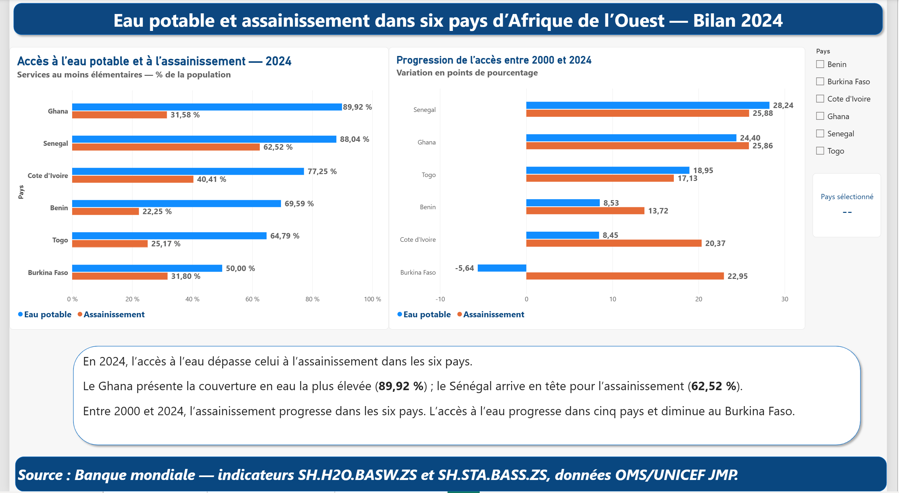
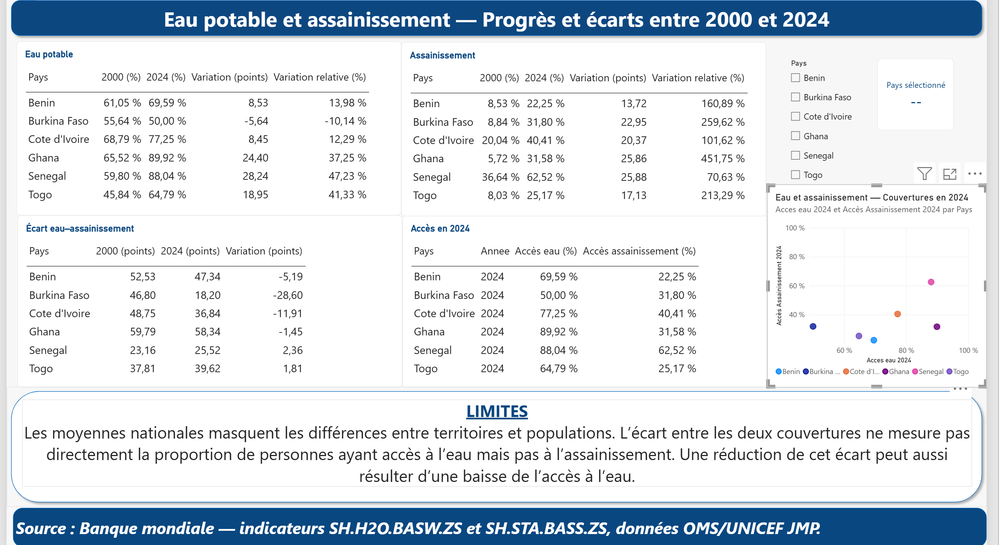
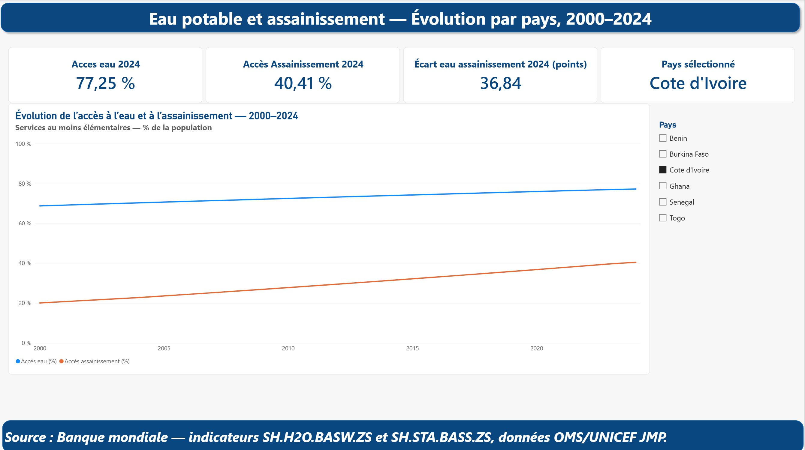

# Eau potable et assainissement en Afrique de l’Ouest — 2000–2024

## Problématique
Les progrès de l’accès à l’eau potable et à l’assainissement avancent-ils au même rythme dans six pays d’Afrique de l’Ouest ?

Projet réalisé dans Power BI : nettoyage et fusion dans Power Query, mesures DAX, comparaison de six pays et exploration annuelle par pays.

## Périmètre
Bénin, Burkina Faso, Côte d’Ivoire, Ghana, Sénégal et Togo. 25 années, 150 lignes pays–année et 300 valeurs renseignées.

## Résultats
- En 2024, la couverture en eau dépasse celle de l’assainissement dans les six pays.
- Le Ghana arrive en tête pour l’eau (89,92 %) ; le Sénégal pour l’assainissement (62,52 %).
- L’assainissement progresse dans les six pays. L’eau progresse dans cinq pays et recule au Burkina Faso (−5,64 points).
- L’écart se réduit dans quatre pays ; il se creuse au Sénégal et au Togo.
- En Côte d’Ivoire, l’eau passe de 68,79 % à 77,25 %, et l’assainissement de 20,04 % à 40,41 %. L’écart se réduit de 11,91 points.

| Pays | Eau 2000 (%) | Eau 2024 (%) | Gain eau (points) | Assainissement 2000 (%) | Assainissement 2024 (%) | Gain assainissement (points) | Variation écart (points) |
|---|---:|---:|---:|---:|---:|---:|---:|
| Bénin | 61,05 | 69,59 | 8,53 | 8,53 | 22,25 | 13,72 | -5,19 |
| Burkina Faso | 55,64 | 50,00 | -5,64 | 8,84 | 31,80 | 22,95 | -28,60 |
| Côte d’Ivoire | 68,79 | 77,25 | 8,45 | 20,04 | 40,41 | 20,37 | -11,91 |
| Ghana | 65,52 | 89,92 | 24,40 | 5,72 | 31,58 | 25,86 | -1,45 |
| Sénégal | 59,80 | 88,04 | 28,24 | 36,64 | 62,52 | 25,88 | 2,36 |
| Togo | 45,84 | 64,79 | 18,95 | 8,03 | 25,17 | 17,13 | 1,81 |

Les variations sont calculées sur les valeurs complètes, puis arrondies.

## Rapport

Le nuage de points conserve des axes resserrés, selon le choix de présentation de l’auteur. La carte du pays affiche « -- » en l’absence d’un pays unique. Les captures sont celles fournies par l’auteur.

## Reproduire
Ouvrir le PBIX dans Power BI Desktop. Adapter les chemins des deux classeurs dans Power Query avant actualisation. Les CSV indépendants sont encodés en UTF-8, séparateur virgule, point décimal. Conserver la précision complète pour les calculs.

Voir [méthode](METHODE.md), [dictionnaire](DICTIONNAIRE.md) et [vérification](VERIFICATION.md).

## Limites
Les moyennes nationales masquent les disparités territoriales et sociales. Un service au moins élémentaire n’est pas nécessairement un service géré en toute sécurité. L’écart entre deux couvertures ne mesure pas la proportion exacte de personnes ayant l’eau mais pas l’assainissement. Une réduction de cet écart peut résulter d’une baisse de la couverture en eau. Les pourcentages ne doivent pas être additionnés entre pays ; leur moyenne simple n’est pas une couverture régionale pondérée. Ces comparaisons descriptives ne permettent pas d’attribuer les évolutions à une cause.

## Sources
Source : Banque mondiale, données OMS/UNICEF Joint Monitoring Programme (JMP).
- [Eau potable — SH.H2O.BASW.ZS](https://data.worldbank.org/indicator/SH.H2O.BASW.ZS)
- [Assainissement — SH.STA.BASS.ZS](https://data.worldbank.org/indicator/SH.STA.BASS.ZS)
- [Définitions eau — JMP](https://washdata.org/topics/drinking-water)
- [Définitions assainissement — JMP](https://washdata.org/topics/sanitation)

Estimations officielles, non simulées. Analyse des éditions des classeurs conservées dans ce dépôt ; des révisions ultérieures peuvent modifier les séries. Date exacte du téléchargement initial non documentée. Licence des indicateurs Banque mondiale : CC BY 4.0.
